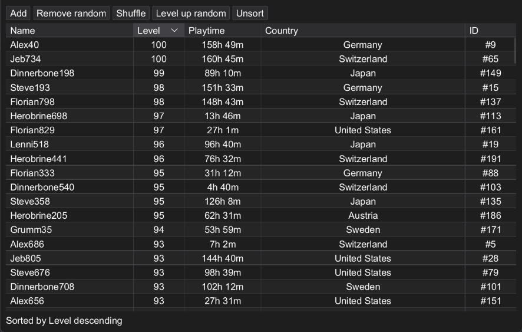
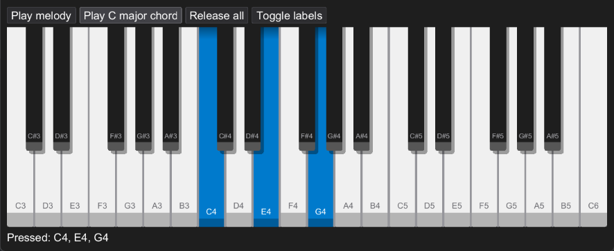

# rivet-extras

Various additional components for the rivet UI library.

## Usage

```kotlin
repositories {
    maven("https://maven.florianreuth.de/snapshots")
}

dependencies {
    implementation("de.florianreuth:rivet-extras:1.0.0-SNAPSHOT")
}
```

### Table



Click a header to sort (ascending, descending, unsorted), drag a header edge to resize, double-click it to fit the content.
Column widths are fractions of the table width, columns without a width share the remaining space. Resizing moves the edge between two columns, the table width stays the same.

```java
TableColumn<Person> name = new TableColumn<Person>("Name", p -> new Label(p.name()))
        .comparator(Comparator.comparing(Person::name));
TableColumn<Person> age = new TableColumn<Person>("Age", p -> new Label(String.valueOf(p.age())))
        .comparator(Comparator.comparingInt(Person::age))
        .width(0.2F);

Table<Person> table = new Table<>(people, List.of(name, age));
rivet.root().add(table);
```

### Piano Keyboard



A piano keyboard spanning a range of MIDI notes (60 = C4, middle C). The range has to start and end on a white key.
Keys are played by clicking, dragging over the keys plays a glissando. Notes can also be pressed programmatically, e.g. to visualize playback.

```java
PianoKeyboard piano = new PianoKeyboard(48, 84); // C3 - C6
piano.notePressListener().add(note -> channel.noteOn(note, 90));
piano.noteReleaseListener().add(channel::noteOff);
piano.press(60).press(64).press(67); // C major chord
rivet.root().add(piano);
```

## Demos

Demo applications for all components are located in `src/demo`:

A demo is started by running the `main` method of its class.

## Contact

- Issues: https://github.com/florianreuth/rivet-extras/issues
- Discord: https://florianreuth.de/discord
